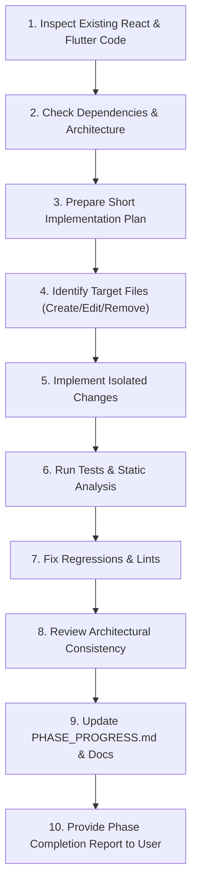

# 📋 React to Flutter Migration & Modernization — Phased Execution Blueprint

> **Role & Responsibility**: Senior Flutter Architect, Software Engineer, UI/UX Engineer, Firebase Specialist, and Technical Project Manager.  
> **Source of Truth**: Existing React PWA codebase (`react_app/`)  
> **Target Production Codebase**: Flutter Cross-Platform App (`flutter_app/`)

---

## 🏛️ Non-Negotiable Architectural Principles

1. **Feature-First Modular Architecture**:
   - Organize code by features (`features/<feature_name>/{data, domain, presentation}`).
   - Presentation layer contains pages, widgets, and state providers.
   - Domain layer contains pure business logic, entities, repository interfaces, and use cases (zero Flutter/Firebase dependencies).
   - Data layer contains models, data sources (Firestore, Hive, API), and repository implementations.
2. **Anti-Monolith & Modular File Standards**:
   - Zero 1000+ line screens or giant monolithic widgets.
   - Zero mixing of UI rendering, business logic calculations, and database calls in a single file.
   - Strictly no hardcoded business rules or calculations inside UI widgets.
3. **Single Source of Truth & Centralized Data Layer**:
   - Repository pattern as the boundary between business logic and data sources.
   - Centralized Firebase initialization and error handling.
   - Single state management strategy (Riverpod recommended) with predictable transitions.
4. **Offline-First & Security Standards**:
   - Local caching / offline persistence (Hive / SQLite) with seamless cloud synchronization.
   - Never expose Firebase Admin SDK credentials, private keys, or service accounts in Flutter client code.
   - Rely strictly on Firebase Authentication & Cloud Firestore Security Rules.

---

## 🗺️ Master Phase Breakdown & Execution Plan

```
┌────────────────────────────────────────────────────────────────────────┐
│ PHASE 0: Discovery, Deep Audit & Feature Inventory                     │
├────────────────────────────────────────────────────────────────────────┤
│ PHASE 1: Architecture Foundation, DI, Theme & Router Setup             │
├────────────────────────────────────────────────────────────────────────┤
│ PHASE 2: Core Data Layer, Domain Entities & Repository Contracts       │
├────────────────────────────────────────────────────────────────────────┤
│ PHASE 3: Design System Tokens & Shared UI Component Library            │
├────────────────────────────────────────────────────────────────────────┤
│ PHASE 4: Feature-by-Feature Migration (Incremental & Isolated)         │
├────────────────────────────────────────────────────────────────────────┤
│ PHASE 5: Mathematical Engine & Attendance Calculation Precision        │
├────────────────────────────────────────────────────────────────────────┤
│ PHASE 6: Cloud Firestore Sync, Offline Storage & Real-time Listeners   │
├────────────────────────────────────────────────────────────────────────┤
│ PHASE 7: Verification, Automated Testing & QA Matrix                   │
├────────────────────────────────────────────────────────────────────────┤
│ PHASE 8: Performance Profiling, Memory Optimization & Security Audit   │
├────────────────────────────────────────────────────────────────────────┤
│ PHASE 9: Production Hardening, Release Build & Final Deployment Ready  │
└────────────────────────────────────────────────────────────────────────┘
```

---

### 🔍 PHASE 0: Project Discovery, Code Audit & Inventory

> [!IMPORTANT]
> **First Action Rule**: Start with Phase 0 only. Do not modify or write source code during this phase. Complete discovery, analysis, and report generation first.

#### Objectives
Conduct a comprehensive line-by-line audit of both `react_app/` and `flutter_app/` to map existing functionality, data structures, business logic, dependencies, and identify migration gaps.

#### Action Items & Checklist
- [ ] **React Application Inventory (`react_app/`)**:
  - [ ] Audit `src/utils/attendance.js` (percentage calculation, safe bunk math, recovery classes needed).
  - [ ] Audit `src/utils/dataModel.js` (Subject schema, Attendance status enums, migration helpers).
  - [ ] Audit `src/utils/date.js` (academic calendar, class days vs holidays, date math).
  - [ ] Audit `src/utils/sync.js` & `backup.js` (conflict resolution, entity versioning, export/import).
  - [ ] Audit `src/services/cloudSync.js` & `api/` (debounced sync, leaderboard endpoints, cron notifications).
  - [ ] Audit state management (`AppContext.jsx`) and custom hooks (`useReminders`, `useInstallPrompt`, `useMediaQuery`).
  - [ ] Catalog all pages: `DashboardPage`, `LeaderboardPage`, `NotesPage`, `OnboardingPage`, `RegisterPage`, `SettingsPage`.
  - [ ] Catalog all visual components: `Heatmap`, `Ring`, `Stepper`, `TimetableEditor`, `DrawerMenu`, `AdminDashboard`.
- [ ] **Flutter Baseline Audit (`flutter_app/`)**:
  - [ ] Inspect existing `lib/core/services/database_service.dart` (Hive implementation).
  - [ ] Inspect `lib/core/utils/attendance_calculator.dart` and compare precision against `react_app/src/utils/attendance.js`.
  - [ ] Inspect `lib/screens/dashboard_screen.dart` and identify monolithic parts to be modularized.
  - [ ] Audit `pubspec.yaml` dependencies and analyze compatibility with Flutter 3.x / Dart 3.x null safety.
- [ ] **Firebase & Backend Audit**:
  - [ ] Inspect `firestore.rules` and document collection schemas: `users/{uid}`, `leaderboard`, reminders.
  - [ ] Verify authentication flow (Google Sign-In, Email/Password, Anonymous).

#### Deliverables
- `AUDIT_REPORT.md`: Complete feature mapping matrix (React feature ➔ Flutter status).
- Gap analysis and risk assessment report.
- Approval milestone to transition into Phase 1.

---

### 🏗️ PHASE 1: Architecture Foundation, DI, Theming & Navigation

#### Objectives
Establish the clean architecture framework, dependency injection, state management architecture, design tokens, and declarative routing.

#### Action Items & Checklist
- [ ] **Folder Structure Setup (`flutter_app/lib/`)**:
  ```
  lib/
  ├── app/
  │   ├── app.dart
  │   ├── bootstrap.dart
  │   ├── router/          # GoRouter configuration
  │   └── theme/           # AppTheme, Dark/Light ThemeData
  ├── core/
  │   ├── constants/       # AppColors, AppSpacing, AppTypography
  │   ├── errors/          # Failure & Exception classes
  │   ├── services/        # Storage, Analytics, Notifications
  │   └── utils/           # Math & Date formatters
  ├── shared/
  │   ├── widgets/         # AppButton, AppCard, AppTextField
  │   └── models/          # Common value objects
  └── features/            # Feature modules
  ```
- [ ] **Dependency Injection & State Management**:
  - [ ] Configure Riverpod (`ProviderContainer` / `ConsumerWidget`) or clean service locator (`get_it`).
  - [ ] Establish centralized global error handling and logging (`talker_flutter` or custom logger).
- [ ] **Design System Tokens**:
  - [ ] Create `AppColors.dart` matching React CSS custom properties (`--primary`, `--bg-dark`, etc.).
  - [ ] Create `AppTypography.dart` (GoogleFonts Inter typography hierarchy).
  - [ ] Create `AppSpacing.dart` and `AppRadius.dart`.
  - [ ] Implement seamless Light/Dark mode switching matching React's theme toggle.
- [ ] **Declarative Routing**:
  - [ ] Set up `go_router` with routes for Splash, Auth, Onboarding, Dashboard, Analytics, Timetable, Leaderboard, Settings.

#### Deliverables
- Fully bootstrapped Flutter app with working routing, theme switching, and zero analyzer errors.

---

### 💾 PHASE 2: Core Data Layer, Domain Entities & Repository Contracts

#### Objectives
Create pure domain entities, serialization-safe data models, and abstract repository contracts that cleanly isolate business logic from Hive and Firestore.

#### Action Items & Checklist
- [ ] **Domain Entities (Pure Dart — Zero Flutter/Firebase imports)**:
  - [ ] `SubjectEntity` (id, name, attendedClasses, totalClasses, targetPercentage, icon, color).
  - [ ] `AttendanceRecordEntity` (id, subjectId, date, status: present/absent/cancelled).
  - [ ] `TimetableEntity` (dayOfWeek, timeSlots, subjectReferences).
  - [ ] `UserStatsEntity` (overallPercentage, streakDays, badgesEarned, safeBunksRemaining).
- [ ] **Data Models & Adapters (Data Layer)**:
  - [ ] `SubjectModel` with `toMap()`, `fromMap()`, `fromJson()`, `toJson()`.
  - [ ] Hive TypeAdapters for offline storage speed and zero-loss serialization.
  - [ ] Firestore snapshot converters with defensive null-checks.
- [ ] **Repository Interfaces & Implementations**:
  - [ ] `SubjectRepository` (`getSubjects`, `watchSubjects`, `saveSubject`, `deleteSubject`).
  - [ ] `AttendanceRepository` (`logAttendance`, `getRecordsForDate`, `getHistoryRange`).
  - [ ] `UserRepository` (`getUserProfile`, `syncWithCloud`, `exportBackup`, `restoreBackup`).
- [ ] **Offline-First Synchronization Engine**:
  - [ ] Implement write-through caching: Write immediately to local Hive database, debounce cloud sync to Firestore.

#### Deliverables
- Compilable and unit-tested Domain and Data layers with 100% backward data compatibility with React's Firestore data.

---

### 🎨 PHASE 3: Core UI Design System & Shared Component Library

#### Objectives
Build high-fidelity, reusable Flutter widgets matching the React UI styling (Glassmorphism, gradients, micro-interactions).

#### Action Items & Checklist
- [ ] **Base UI Components**:
  - [ ] `AppButton` (Primary, Secondary, Destructive, Outline, with loading spinners).
  - [ ] `AppTextField` (clean borders, floating labels, validation states).
  - [ ] `AppCard` (Elevation, subtle border gradients, rounded corners).
- [ ] **Specialized Attendance Widgets**:
  - [ ] `AttendanceRingWidget`: Circular progress indicator color-coded based on attendance threshold (Green ≥ 75%, Amber 65-74%, Red < 65%).
  - [ ] `BunkAdvisorBadge`: "Can bunk X classes safely" / "Must attend Y consecutive classes".
  - [ ] `StreakCounterWidget`: Flame icon animation + streak counter.
- [ ] **Navigation & Shell**:
  - [ ] Responsive navigation shell (Bottom Navigation Bar for Mobile, Navigation Rail / Drawer for Tablet/Desktop).
  - [ ] App drawer matching React's `DrawerMenu.jsx`.

#### Deliverables
- Reusable UI component library verified with interactive widget tests and preview catalog.

---

### 🚀 PHASE 4: Feature-by-Feature Migration

> [!NOTE]
> Execute each feature sequentially. Complete development, matching, and testing before moving to the next feature.

#### Feature 4.1: Authentication & Onboarding
- [ ] Google Sign-In & Firebase Auth integration.
- [ ] Guest / Offline-first anonymous user mode (local Hive only).
- [ ] Setup wizard: College name, semester, target attendance threshold (default: 75%).

#### Feature 4.2: Main Dashboard
- [ ] Overall Attendance Overview Card with circular progress and instant summary.
- [ ] Quick Action Subject Cards: Single-tap "+ Present", "- Absent" with haptic feedback.
- [ ] Safe Bunk / Class Recovery advisor banner.
- [ ] Daily streak counter and badge indicator.

#### Feature 4.3: Subject Management & Detailed Analytics
- [ ] Add / Edit / Reorder / Delete Subject dialogs with custom color and icon selectors.
- [ ] Detailed analytics screen per subject: Historical trend graph, conducted vs attended breakdown.
- [ ] Custom attendance threshold overrides per subject.

#### Feature 4.4: Timetable & Automated Day Schedule
- [ ] Weekly timetable configuration grid matching `TimetableEditor.jsx`.
- [ ] "Today's Schedule" card dynamically showing today's lectures.
- [ ] Mark entire day's scheduled classes in one click.

#### Feature 4.5: Calendar View & GitHub-style Contribution Heatmap
- [ ] Monthly calendar picker with colored attendance dots matching `CalendarView.jsx`.
- [ ] GitHub-style Heatmap visualizer showing attendance intensity across the semester (`Heatmap.jsx`).

#### Feature 4.6: Leaderboard & Gamification
- [ ] Anonymized / Username-based college leaderboard (`LeaderboardPage.jsx`).
- [ ] Badge tier system: Bronze, Silver, Gold, Platinum streaks.

#### Feature 4.7: Settings, Backup & Cloud Sync
- [ ] Cloud backup and JSON export/import matching `backup.js`.
- [ ] Manual "Sync Now" button with timestamp indicator.
- [ ] Account deletion, privacy policy, and theme selection.

---

### 🧮 PHASE 5: Business Logic & Mathematical Engine Precision

#### Objectives
Port the mathematical formulas from `react_app/src/utils/attendance.js` into a robust, pure Dart domain calculation engine with 100% mathematical parity.

#### Mathematical Parity Checklist
- [ ] **Attendance Percentage**:
  $$\text{Percentage} = \frac{\text{Attended Classes}}{\text{Total Classes}} \times 100$$
  *(Ensure safe handling of $\text{Total} = 0$, returning null or $0.0\%$, matching React)*.
- [ ] **Maximum Allowable Absences (Safe Bunk Math)**:
  $$\text{Safe Bunk} = \left\lfloor \frac{\text{Attended} - (\text{Target\%} \times \text{Total})}{\text{Target\%}} \right\rfloor$$
- [ ] **Required Recovery Classes (Classes Needed)**:
  $$\text{Classes Needed} = \left\lceil \frac{(\text{Target\%} \times \text{Total}) - \text{Attended}}{1 - \text{Target\%}} \right\rceil$$
- [ ] **Edge Cases**:
  - [ ] Target percentage at exact boundaries ($75.0\%$, $74.99\%$).
  - [ ] Mid-semester syllabus addition / cancelled classes without penalizing student record.
  - [ ] Multi-class blocks on the same day.
- [ ] **Automated Test Matrix**:
  - [ ] Write Dart unit tests mirroring all 9 tests from `react_app/tests/attendance.test.js`.

---

### 🔄 PHASE 6: Cloud Sync, Push Notifications & Offline Consistency

#### Objectives
Implement real-time sync with Firebase Firestore, push reminders, and rock-solid conflict resolution.

#### Action Items & Checklist
- [ ] **Cloud Firestore Integration**:
  - [ ] 5-second debounced background sync matching React's `cloudSync.js`.
  - [ ] Last-Write-Wins (LWW) entity timestamp merge strategy matching `sync.js`.
  - [ ] Soft deletion preservation (`isDeleted: true`).
- [ ] **Local Notification Reminders**:
  - [ ] `flutter_local_notifications` for offline daily class reminder (5:00 PM).
  - [ ] FCM background message handling matching `firebase-messaging-sw.js`.
- [ ] **Network Connectivity Handling**:
  - [ ] `connectivity_plus` listener: Queue changes when offline, auto-flush when online.

---

### 🧪 PHASE 7: Testing & Quality Assurance

#### Objectives
Verify zero regressions, complete parity with React, and zero Dart analyzer warnings.

#### Action Items & Checklist
- [ ] **Static Analysis**:
  ```bash
  flutter analyze
  ```
  *Requirement: 0 errors, 0 warnings, strict lints enforced.*
- [ ] **Unit Tests**:
  - [ ] Mathematical engine unit tests (`test/unit/attendance_calculator_test.dart`).
  - [ ] Entity serialization tests (`test/unit/subject_model_test.dart`).
  - [ ] Sync merge conflict tests (`test/unit/sync_engine_test.dart`).
- [ ] **Widget & Integration Tests**:
  - [ ] Dashboard interaction test (tap "+", counter updates, advice message updates).
  - [ ] Subject creation flow test.
- [ ] **Side-by-Side Visual Regression Audit**:
  - [ ] Compare React Web on mobile viewport vs Flutter Android emulator.

---

### ⚡ PHASE 8: Performance Profiling & Security Hardening

#### Objectives
Ensure 60/120 FPS UI performance, zero memory leaks, and airtight Firebase security.

#### Action Items & Checklist
- [ ] **Performance Optimization**:
  - [ ] Profile build cycles via Flutter DevTools: Ensure no unnecessary widget rebuilds.
  - [ ] Implement `const` constructor hygiene throughout UI tree.
  - [ ] Ensure lazy ListView builder rendering for long subject/history lists.
- [ ] **Security Audit**:
  - [ ] Ensure no secret API keys or service accounts in Flutter repository.
  - [ ] Test Firestore Security Rules against unauthorized read/write attempts.
  - [ ] Sanitize input strings in subject names and notes.

---

### 📦 PHASE 9: Production Readiness & Release Preparation

#### Objectives
Generate production release binaries, setup app icon, splash screen, and release signing.

#### Action Items & Checklist
- [ ] **Assets & Branding**:
  - [ ] Configure `flutter_launcher_icons` using `react_app/public/logo.jpg` & `icon.svg`.
  - [ ] Configure native splash screen (`flutter_native_splash`).
- [ ] **Android Production Build**:
  - [ ] Configure `android/app/build.gradle` (minSdkVersion 21, targetSdkVersion 34+).
  - [ ] Set up keystore signing configuration for release bundle.
  - [ ] Generate release Android App Bundle (AAB):
    ```bash
    flutter build appbundle --release
    ```
- [ ] **Release Documentation**:
  - [ ] Final `README.md` and user manual.
  - [ ] Play Store listing assets, descriptions, and privacy policy verification.

---

## 🚦 Phase Execution Protocol (Mandatory Workflow)

For every phase from Phase 0 to Phase 9, strictly follow these 10 steps:



### Mandatory Completion Report Format
After each phase, submit:
1. **Summary of Implementation**: What was built and verified.
2. **Files Created**: List of all new files with responsibilities.
3. **Files Modified / Removed**: Exact diff context and justification.
4. **Tests Executed & Results**: Pass/Fail metrics.
5. **Known Issues & Mitigations**: Any deferred items.
6. **Next Phase Prerequisites**: Clear blockers or requirements before moving forward.

---

## 🛑 Strict Development Restrictions

- ❌ Never delete working code without understanding its purpose.
- ❌ Never introduce third-party packages without evaluating necessity and maintenance status.
- ❌ Never change business rules or attendance calculations without explicit approval.
- ❌ Never use placeholder or hardcoded mock data in production flows.
- ❌ Never ignore analyzer warnings or failing tests to claim progress.
- ❌ Never make destructive database changes or alter Firestore schemas without backward compatibility.
